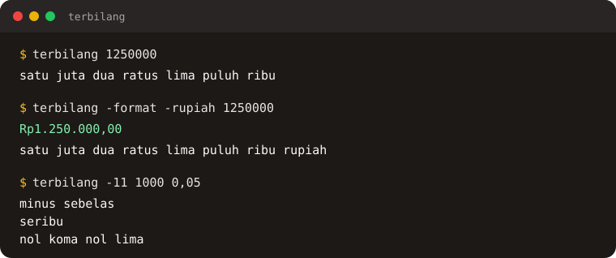

# terbilang-go

Convert numbers into Indonesian words, and format Rupiah the way an invoice or kuitansi expects.

[](https://github.com/EnriqueMuhammad/terbilang-go/actions/workflows/ci.yml)
[](https://goreportcard.com/report/github.com/EnriqueMuhammad/terbilang-go)
[](https://pkg.go.dev/github.com/EnriqueMuhammad/terbilang-go)
[](LICENSE)



```text
$ terbilang 1250000
satu juta dua ratus lima puluh ribu

$ terbilang -format -rupiah 1250000
Rp1.250.000,00
satu juta dua ratus lima puluh ribu rupiah

$ terbilang -11
minus sebelas
```

The library spells integers through desiliun, reads decimals digit by digit after `koma`, and prints Rupiah with Indonesian grouping (`Rp1.250.000,00`).

## Install

The module needs Go 1.22 or newer.

```bash
go get github.com/EnriqueMuhammad/terbilang-go
```

The command line tool:

```bash
go install github.com/EnriqueMuhammad/terbilang-go/cmd/terbilang@latest
```

From a clone of this repository:

```bash
go install ./cmd/terbilang
```

Tagged releases also publish archives through GoReleaser.

## Library

```go
package main

import (
	"fmt"

	"github.com/EnriqueMuhammad/terbilang-go"
)

func main() {
	fmt.Println(terbilang.Convert(1250000))
	fmt.Println(terbilang.Rupiah(1250000))
	fmt.Println(terbilang.FormatRupiah(1250000))

	words, err := terbilang.Parse("10,05")
	if err != nil {
		panic(err)
	}
	fmt.Println(words)

	invoice, err := terbilang.ParseRupiah("1.250.000,50")
	if err != nil {
		panic(err)
	}
	fmt.Println(invoice)
}
```

```text
satu juta dua ratus lima puluh ribu
satu juta dua ratus lima puluh ribu rupiah
Rp1.250.000,00
sepuluh koma nol lima
satu juta dua ratus lima puluh ribu rupiah lima puluh sen
```

| Function | What it does |
| --- | --- |
| `Convert(n int64) string` | Integer to words. `0` is `nol`. Negatives start with `minus`. |
| `Parse(s string) (string, error)` | Same reading, plus decimals and grouped input. |
| `Rupiah(n int64) string` | `Convert` with a `rupiah` suffix. |
| `RupiahSen(rupiah, sen) (string, error)` | Invoice reading. Sen is `0`–`99` and is omitted when zero. |
| `FormatRupiah(n int64) string` | `Rp1.250.000,00` |
| `FormatRupiahSen(rupiah, sen) (string, error)` | Same format with a sen part. |
| `ParseRupiah` / `FormatRupiahString` | The string forms, for values such as `1,5` or `Rp 1.250.000,50`. |

`Parse`, `ParseRupiah`, and `FormatRupiahString` return `ErrEmpty`, `ErrSyntax`, or `ErrMagnitude`. `RupiahSen` and `FormatRupiahSen` return `ErrSen` when sen is outside `0`–`99`.

## Command line

```text
terbilang [flags] [number ...]
```

With no numbers, `terbilang` reads standard input. A line can hold one number (`Rp 1.250.000,00` is fine) or several separated by spaces. Blank lines and lines that start with `#` are skipped. Running it with no arguments in a terminal prints help.

| Flag | Effect |
| --- | --- |
| `-rupiah` | Append `rupiah`. A fraction of one or two digits becomes sen. |
| `-format` | Print `Rp1.250.000,00` instead of words. |
| `-version` | Print the version. |

Pass both `-rupiah` and `-format` to print the currency form and the words. Each number is one line of output. Exit status is `0` on success, `1` when a number is rejected, and `2` for usage errors.

```bash
terbilang 100 1000 1000000
echo 'Rp 10.000,50' | terbilang -rupiah -format
terbilang -11
```

## Examples

| Input | Words |
| --- | --- |
| `0` | nol |
| `11` | sebelas |
| `12` | dua belas |
| `21` | dua puluh satu |
| `100` | seratus |
| `115` | seratus lima belas |
| `1000` | seribu |
| `1111` | seribu seratus sebelas |
| `1000000` | satu juta |
| `1250000` | satu juta dua ratus lima puluh ribu |
| `-1250000` | minus satu juta dua ratus lima puluh ribu |
| `1000000000` | satu miliar |
| `1000000000000` | satu triliun |
| `1,05` | satu koma nol lima |
| `0,5` | nol koma lima |
| `10.000` | sepuluh ribu |
| `1.250.000,50` | satu juta dua ratus lima puluh ribu koma lima nol |

Rupiah on the same amounts:

| Input | Format | Terbilang |
| --- | --- | --- |
| `1250000` | `Rp1.250.000,00` | satu juta dua ratus lima puluh ribu rupiah |
| `1500` and `50` sen | `Rp1.500,50` | seribu lima ratus rupiah lima puluh sen |
| `0,05` | `Rp0,05` | lima sen |
| `-0,50` | `-Rp0,50` | minus lima puluh sen |
| `1,5` | `Rp1,50` | satu rupiah lima puluh sen |

A single fractional digit is a tenth, so `1,5` rupiah is 50 sen, not 5 sen. More than two fractional digits is rejected in rupiah mode. `Parse` still reads them after `koma` (`3,141` is `tiga koma satu empat satu`).

## How a number is read

Indonesian grouping and a decimal point share the `.` character, so the parser follows a fixed rule:

- Digits only: an integer. `1250` is seribu dua ratus lima puluh.
- A comma is the decimal mark. `1,25` is `satu koma dua lima`. `1,250` is `satu koma dua lima nol`, not seribu dua ratus lima puluh.
- Repeated commas are thousands separators, as in `1,250,000`.
- Repeated dots are Indonesian thousands separators, as in `1.250.000`.
- One dot followed by exactly three digits is also a thousands separator: `10.000` is sepuluh ribu and `1.250` is seribu dua ratus lima puluh.
- Any other single dot is a decimal point: `1.5`, `1.50`, `3.14159`. A zero integer part stays decimal, so `0.250` is `nol koma dua lima nol`.
- When both `.` and `,` appear, the rightmost one is the decimal mark. `1.250.000,50` and `1,250,000.50` are the same amount.

An optional `+` or `-` and an `Rp` prefix are accepted, including a space after `Rp`.

Fractional digits are spoken one by one, which keeps zeros: `1,05` is `satu koma nol lima`, not `satu koma lima`.

The special forms used on invoices:

| Value | Reading | Not |
| --- | --- | --- |
| 11 | sebelas | satu belas |
| 100 | seratus | satu ratus |
| 1000 | seribu | satu ribu |
| 1000000 | satu juta | sejuta |
| 10^9 | satu miliar | satu milyar |

`miliar` is the current KBBI spelling. Scales continue `triliun`, `kuadriliun`, `kuintiliun`, `sekstiliun`, `septiliun`, `oktiliun`, `noniliun`, `desiliun`.

`Convert` accepts every `int64`, including `math.MinInt64`. `Parse` accepts up to 36 integer digits (through desiliun) and 64 fractional digits. Past that it returns `ErrMagnitude` or `ErrSyntax`.

## Contributing

See [CONTRIBUTING.md](CONTRIBUTING.md). `go test ./...` runs the table tests, the godoc examples, and the benchmarks.

## License

[MIT](LICENSE) © Enrique Muhammad Ilham
